# AgentGuard Console — 大模型运行时安全护栏与治理控制台

[](#开源协议与致谢)
[](#快速启动本地联调)
[](#核心模块与技术架构)
[](#前端控制台使用指南3-个核心页面)
[](#测试与量化评测结果)
[](#核心工程亮点与技术细节)

> **让大模型安全“看得见、测得出、防得住”**：本项目是基于开源项目 [`MANIGAAA27/agentguard`](https://github.com/MANIGAAA27/agentguard)（MIT License）深度增强的全栈 **LLM Guardrails Gateway & AI Governance Console**。  
> **后端**提供零重型外部依赖、亚毫秒级（P95 < 1ms）的多平面安全网关；**前端**提供零臃肿 UI 依赖的 React + TypeScript 暗色安全运营控制台（Dark SOC），支持访客一键触发真实攻防用例、查看脱敏与 `<think>` 剥离修复对比、运行红队基准跑分与多租户审计追踪。

---

## 目录

- [1. 为什么需要这个项目？（核心痛点）](#1-为什么需要这个项目核心痛点)
- [2. 仓库目录结构](#2-仓库目录结构)
- [3. 核心模块与技术架构](#3-核心模块与技术架构)
- [4. 核心工程亮点与技术细节](#4-核心工程亮点与技术细节)
- [5. 快速启动本地联调](#5-快速启动本地联调)
- [6. 前端控制台使用指南（3 个核心页面）](#6-前端控制台使用指南3-个核心页面)
- [7. 后端核心 API 接口一览](#7-后端核心-api-接口一览)
- [8. 测试与量化评测结果](#8-测试与量化评测结果)
- [9. 已知边界与演进路线](#9-已知边界与演进路线)
- [10. 开源协议与致谢](#10-开源协议与致谢)

---

## 1. 为什么需要这个项目？（核心痛点）

在实际业务落地大语言模型（LLM）与智能体（Agent）时，开发者面临四类典型生产风险：
1. **提示词注入与越狱（Prompt Injection & Jailbreak）**：恶意用户通过中/英文覆盖指令、Base64 编码混淆、德语跨语种绕过或分隔符截断，套取系统提示词或解除安全护栏。
2. **个人隐私与云密钥外泄（PII & Secret Leakage）**：员工误将手机号、身份证号或云服务密钥（OpenAI `sk-`、阿里云 `LTAI` AK、AWS `AKIA`）发往外部模型；同时传统粗暴正则常把 **18 位电商订单号误判为身份证号** 导致业务大面积瘫痪。
3. **推理链泄露与上下文幻觉（Reasoning Leak & Hallucination）**：以 DeepSeek-R1 为代表的推理模型会在 `<think>...</think>` 标签内暴露内部策略或底价公式；或者模型回答中的价格/日期与 RAG 检索到的企业文档相矛盾。
4. **Agent 工具参数注入（Nested Tool Payload Injection）**：模型虽然调用的是白名单允许的工具（如 `search_documents`、`update_record`），但黑客在嵌套 JSON 参数中偷偷夹带 SQL 注入（`DROP TABLE`）、路径穿越（`../../../etc/passwd`）或命令注入（`&& curl ... | sh`）。

**AgentGuard Fullstack** 充当应用与大模型/工具之间的 **L1 确定性安全控制面（Control Plane）**，在请求进入模型前、离开模型后与调用工具前完成毫秒级拦截、柔性脱敏（Redact）、自动修复（Repair）与人机协同审批（HITL）。

---

## 2. 仓库目录结构

```text
.
├── 后端/                                   # FastAPI + Pydantic v2 安全护栏网关
│   ├── src/agentguard/
│   │   ├── main.py                         # 应用入口、CORS 配置、生命周期与健康检查
│   │   ├── config.py                       # Pydantic Settings（仓库根路径锚定、可配置策略/延迟头）
│   │   ├── common/                         # RequestContext、Latency 中间件、Correlation-ID 追踪
│   │   ├── gateway/                        # 统一推理入口、认证与内存/Redis 限流
│   │   ├── input_guardrails/               # 7 路并发输入检查引擎（注入/越狱/PII/密钥/外泄/毒性/受限主题）
│   │   ├── output_validation/              # 8 路并发输出校验引擎（Canary/<think>修复/中英文幻觉核验/Schema）
│   │   ├── retrieval/                      # 双语 Hybrid BM25 检索溯源与置信度过滤
│   │   ├── action_governance/              # 工具白名单、递归嵌套参数注入扫描、风险评分与人工审批
│   │   ├── policy/                         # 声明式 YAML Policy-as-Code 规则引擎
│   │   ├── prompt_framework/               # 版本化 Prompt 包编译与 Linter
│   │   ├── slop_score/                     # 复合输出质量风险评分（quality_risk_score）
│   │   └── observability/                  # 多租户审计流水、Prometheus 指标与在线 Benchmark 运行器
│   ├── policies/                           # 默认 YAML 策略文件
│   ├── prompt_packages/                    # 版本化 Prompt 示例包
│   ├── reports/benchmark_summary.json      # 21 用例红队防线量化基准报告
│   ├── scripts/benchmark_redteam_defense.py# 一键可复现基准评测 CLI
│   └── tests/                              # 161 个 Pytest 单元、双胞胎反例与 API 契约测试
│
└── 前端/                                   # React 18 + TypeScript (Strict) Dark SOC 控制台
    ├── src/
    │   ├── api/client.ts                   # 强类型 API 客户端（X-Tenant-ID 注入 & 响应头追踪提取）
    │   ├── types/guardrails.ts             # 严格对齐后端 Schema 的全套 TypeScript 类型定义
    │   ├── presets/samples.ts              # 18 组开箱即用的攻防/RAG/工具治理预设样本
    │   ├── components/
    │   │   ├── GuardrailPlayground.tsx     # Tab 1：输入护栏检测台 & 输出校验/<think>修复台
    │   │   ├── RagAndActionConsole.tsx     # Tab 2：双语 RAG 溯源台 & Agent 工具授权台
    │   │   └── BenchmarkAndAudit.tsx       # Tab 3：21 用例基准跑分控制台 & 多租户审计监控台
    │   ├── App.tsx                         # 全局顶栏（租户切换、Live Trace Correlation-ID / Latency）
    │   └── index.css                       # 零外部 UI 库的暗色安全运营大屏样式
    ├── vite.config.ts                      # 本地开发代理（/v1、/health -> 127.0.0.1:8000）
    └── package.json                        # 仅包含 react / react-dom / vite / typescript，极简干净
```

---

## 3. 核心模块与技术架构

```mermaid
flowchart LR
    UI["React 安全控制台<br/>(前端: 5173)"] -->|"/v1/* + X-Tenant-ID"| MW["HTTP 中间件链<br/>CorrelationID · Tenant · Latency"]
    MW --> IN["输入护栏 Engine<br/>7 路并发 asyncio.gather"]
    IN -->|"allow / redact / block"| GW["Prompt 编译 & RAG 双语 BM25 溯源"]
    GW --> LLM["LLM Provider / 推理网关"]
    LLM --> OUT["输出校验 Engine<br/>8 路并发 + SlopScore"]
    OUT -->|"pass / repair(<think>) / reject"| ACT["Agent 工具治理<br/>白名单 + 嵌套载荷扫描"]
    ACT -->|"allow / require-approval / deny"| OBS["Observability<br/>多租户审计流水 & 指标"]

    style IN fill:#7b2d26,color:#fff
    style OUT fill:#8b5e00,color:#fff
    style ACT fill:#1e3a5f,color:#fff
    style OBS fill:#2d5a3d,color:#fff
```



---

## 4. 核心工程亮点与技术细节

### 亮点 1：证据强弱分级与 180 字符滑动窗口注入检测（`LLM01:2025`）
- **核心文件**：`后端/src/agentguard/input_guardrails/checks/prompt_injection.py`、`jailbreak.py`
- **设计思路**：普通正则最大的痛点是误伤正常业务表达（例如 `"I want you to act as an interviewer"` 或 `"encode your response in base64"`）。本网关将注入特征分为两层：
  - **强信号（Weight 4，直拦）**：中/英/德三语明确指令覆盖（如 `Ignore the above`、`Vergiss alles`、`忽略此前规则`）、上下文分隔符逃逸（`======END`）、提示词套取、以及 Base64 隐写解码（`_decode_obfuscated_payloads` 自动还原长度 `>= 24` 且可读字符占比 `>= 85%` 的加密指令后再二次扫描）。
  - **弱候选信号（Weight 2，局部窗口叠加）**：通用角色扮演、输出编码或 SQL 请求单独出现时只记录 `injection_score = 2` 并**安全放行（`allow`）**；仅当同一行 `180` 字符滑动窗口内出现 2 个及以上不同弱信号（总分 `>= 4`）时才阻断。

### 亮点 2：区分“讨论危险话题”与“要求实施侵害行为”（零误杀双胞胎防护）
- **核心文件**：`后端/src/agentguard/input_guardrails/checks/toxicity.py`、`restricted_topics.py`、`data_exfiltration.py`
- **设计思路**：禁用跨整段文本的无界 `.*` 匹配，按句号/换行切分从句，绑定**「生成/实施动词 + 恶意目标对象」**：
  - 将易误报的 `insider trading` 裸词收紧为实施/教唆请求，放行历史新闻写作（如 *"Write an article about how Jeffrey Skilling committed insider trading at Enron"*）。
  - 对恶意软件、网络入侵、仇恨歧视与爆炸物教程限定动作指向并豁免防护/历史语境（如 *"how bomb technology has evolved"*、*"poem about the Holocaust"*）。
  - 代码窃密检测不单独阻断正常 `import subprocess`，而是识别「本地敏感读操作 / `getpass` / `pyautogui` + 网络外发 / 批量删除 / `Fernet` 勒索加密」组合线索。

### 亮点 3：中文 PII 校验码消歧与国产云密钥扫描（`LLM02:2025`）
- **核心文件**：`后端/src/agentguard/input_guardrails/checks/pii_detection.py`、`secret_detection.py`
- **设计思路**：针对中国内地 18 位身份证号实现完整的 **ISO 7064:1983 MOD 11-2 加权校验码算法** 与数字边界约束，自动放行长度同为 18 位的电商订单号/物流单号（如 `110105194912310029`），同时精准脱敏真实身份证与 11 位手机号为 `[REDACTED_ID_CN]` / `[REDACTED_PHONE_CN]`；覆盖 OpenAI/DeepSeek `sk-` 与阿里云 `LTAI...` AccessKey 拦截。

### 亮点 4：Canary 令牌防泄、4-gram 提示词倒灌与 `<think>` 推理链剥离（`LLM07:2025`）
- **核心文件**：`后端/src/agentguard/output_validation/checks/canary_leak.py`、`hallucination_proxy.py`
- **设计思路**：
  - 捕获输出中回显的 `CANARY-` / 自定义诱饵令牌或与 `system_prompt` 的中英文 4-gram 重合率 `>= 0.50` 的复读泄露（直接 `reject`）。
  - 当检测到 `<think>...</think>` 思考过程夹带内部规则时触发柔性 **`repair`**，自动剥离思考标签并把干净文本写入 `metadata["repaired_text"]`（前端可直观展示剥离前后对比）。
  - 双语 `hallucination_proxy` 同时校对人民币金额（`¥/￥/RMB`）、中文日期（`YYYY年M月D日`）及中英文 2-gram 重合度。

### 亮点 5：双语 Hybrid BM25 检索溯源与递归嵌套工具参数防注入
- **核心文件**：`后端/src/agentguard/retrieval/grounding.py`、`后端/src/agentguard/action_governance/router.py`、`risk_scorer.py`
- **设计思路**：
  - 零外部依赖的 `_tokenize_bilingual`（ASCII 词 + CJK 单双字切片）实现 Hybrid BM25（`k1=1.5, b=0.75`）+ 查询覆盖率融合打分，内置 6 篇中英文企业制度文档支持即时体验。
  - `_scan_param_payload_risk()` 递归穿透任意深度的工具入参字典/列表，捕获 SQLi、命令注入与路径穿越后直接将Live 请求判为红色 `DENY`；高风险但无注入的合法操作（如 `bulk_update`）触发黄色 `REQUIRE-APPROVAL`。

---

## 5. 快速启动本地联调

### 环境要求
- **Python 3.11+**（已在 Python 3.14 实测通过）
- **Node.js 18+**（用于运行 Vite + React 前端控制台）

### 第一步：启动后端 API 服务（端口 `8000`）

<details open>
<summary><b>Windows (PowerShell)</b></summary>

```powershell
cd 后端
pip install -e ".[dev]"
$env:PYTHONPATH = "$PWD\src"
python -m uvicorn agentguard.main:app --host 127.0.0.1 --port 8000 --reload
```

</details>

<details>
<summary><b>macOS / Linux (Bash)</b></summary>

```bash
cd 后端
pip install -e ".[dev]"
PYTHONPATH=src python -m uvicorn agentguard.main:app --host 127.0.0.1 --port 8000 --reload
```

</details>

> 提示：后端 `config.py` 已内置仓库根路径锚定，开箱默认开启 `EXPOSE_GUARDRAIL_LATENCY_HEADER=true` 并允许 `http://localhost:5173` 与 `http://127.0.0.1:5173` 跨域访问，**无需手动新建 `.env`** 即可直接联调；如需连接外部 OpenAI / Anthropic / Redis，可参考 `后端/.env.example` 复制为 `.env`。

### 第二步：启动前端安全控制台（端口 `5173`）

打开第二个终端窗口：

```bash
cd 前端
npm install
npm run dev
```

浏览器访问 **`http://localhost:5173`**，顶部状态栏会实时展示当前选中的租户（`X-Tenant-ID`）、每次请求的链路追踪 ID（`X-Correlation-ID`）与网关真实耗时（`X-AgentGuard-Latency-Ms`）。

---

## 6. 前端控制台使用指南（3 个核心页面）

前端所有场景均配有**一键预设按钮**，点击任意预设胶囊即可自动填充参数并触发实时后端检测：

### 页面 1：`护栏演练场`（输入护栏 + 输出校验双栏）
| 区域 | 推荐点击的预设按钮 | 预期决策徽章 | 你能观察到的效果 |
| :--- | :--- | :---: | :--- |
| **左栏：输入护栏** | `系统提示词窃取` / `Base64 注入` / `小说推演绕过` | 🔴 `BLOCK` | 识别中文越狱、自动解码 Base64 密文指令并阻断 |
| **左栏：输入护栏** | `个人敏感信息` | 🟡 `REDACT` | 对比框展示手机号与真实身份证自动打码结果 |
| **左栏：输入护栏** | `订单编号误判` | 🟢 `ALLOW` | 18 位工单号 `110105194912310029` 经校验码识别为非身份证，零误杀放行 |
| **左栏：输入护栏** | `云密钥泄露` | 🔴 `BLOCK` | 精准拦截 `ALIYUN_AK=LTAI...` 凭据 |
| **右栏：输出校验** | `Canary 泄露` / `系统提示词倒灌` | 🔴 `BLOCK` | 捕获诱饵令牌回显与 `system_prompt` 4-gram 泄露 |
| **右栏：输出校验** | `思考链泄密` | 🟡 `REPAIR` | 展示剥离 `<think>...</think>` 内部规则后的安全 `repaired_text` |
| **右栏：输出校验** | `上下文价格冲突` | 🔴 `BLOCK` | 抓出模型报价 `¥99999 / 2029年12月31日` 与上下文 `¥3000` 冲突 |

### 页面 2：`RAG 与工具治理`
- **左栏（双语 RAG 溯源台）**：依次点击 `退款政策（中文）`、`AI & Data Retention Policy (EN)`、`中英混合检索`，可直观查看双语 Hybrid BM25 命中的知识文档、置信度进度条与 `GROUNDED` 状态。
- **右栏（Agent 工具调用授权台）**：
  - `正常文档查询`（`search_documents`）→ 🟢 `ALLOW`（低风险放行）
  - `高危批量审批`（`bulk_update`）→ 🟡 `REQUIRE-APPROVAL`（无注入但属 `critical` 风险工具，需人类审批）
  - `SQL 注入` / `路径穿越读取` / `命令注入` → 🔴 `DENY`（命中嵌套参数载荷注入，实时阻断）

### 页面 3：`基准评测与审计`
- **左侧（基准评测控制台）**：点击 **`运行 21 用例基准评测`**，实时调用 `POST /v1/evals/benchmark`，展示 4 张大卡片指标及逐条用例结果表。
- **右侧（实时审计日志 & 指标）**：自动记录此前在 Tab 1/Tab 2 触发的每次决策。切换右上角 `Tenant` 下拉框（`default` / `finance-prod` / `gov-internal`）并再次测试后，可勾选 **「仅看当前租户」** 验证多租户审计数据隔离。

---

## 7. 后端核心 API 接口一览

启动后端后，可访问 `http://127.0.0.1:8000/docs` 查看交互式 OpenAPI Swagger 文档：

| 方法与路径 | 功能说明 | 关键特性 |
| :--- | :--- | :--- |
| `POST /v1/guardrails/evaluate-input` | 输入安全护栏评估 | 7 路并发检查、`redacted_text` 脱敏输出、返回阶段耗时头 |
| `POST /v1/outputs/validate` | 输出质量与防泄露校验 | 8 路并发、`canary_tokens`、`repaired_text`、`quality_risk_score` |
| `POST /v1/retrieval/search` | 双语检索溯源与置信度过滤 | Hybrid BM25 中英混合分词、返回 `citations` 与 `grounded` |
| `GET /v1/actions/tools` | 获取工具白名单与参数约束 | 返回各工具 `risk_base`、`required_params`、`max_risk` |
| `POST /v1/actions/authorize` | Agent 工具调用风险评分与授权 | 递归嵌套参数注入扫描、支持 `dry_run` 与 `idempotency_key` |
| `POST /v1/policies/evaluate` | Declarative YAML 策略评估 | 支持 `global / tenant / use_case / role / channel` 作用域 |
| `POST /v1/evals/benchmark` | 运行 21 用例红队基准套件 | 纯内存执行，无磁盘写副作用，返回结构化汇总报告 |
| `GET /v1/evals/audit` & `metrics` | 查询审计流水与计数器快照 | 支持按 `tenant_id` 与 `limit` 过滤 |

---

## 8. 测试与量化评测结果

### 8.1 自动化测试与静态代码质量

在 `后端/` 目录下执行：

```bash
pytest -v
ruff check src/ tests/
mypy src/
python scripts/benchmark_redteam_defense.py
```

实测结果：
- **Pytest 单元测试与契约测试**：**`161 passed`**（包含基线测试、前端控制台契约测试及 34 个中/英/德双胞胎成对回归用例）
- **Ruff 代码规范**：**`All checks passed!`**
- **Mypy 严格类型检查（`strict = true`）**：**`Success: no issues found in 76 source files`**
- **前端 TypeScript 编译（`strict: true`）**：`cd 前端 && npm run build` **`0 errors`**

### 8.2 内部红队防线基准（`reports/benchmark_summary.json`）

| 评估维度 | 实测结果 |
| :--- | :--- |
| 覆盖样本总量 | **21 用例**（输入、输出、工具行动三大平面；16 个攻击 + 5 个高混淆良性对照） |
| 攻击拦截 / 脱敏 / 修复成功率 | **`100.0%`（16 / 16）** |
| 良性样本误报率 (FPR) | **`0.0%`（0 / 5）**（含 18 位电商订单号反误判验证） |
| 平均延迟 / P95 延迟 | **`0.08 ms`（平均）/ `0.113 ms`（P95）** |

### 8.3 外部开源权威基准压测（1,037 条野生样本，升级前后实测对比）

为了验证规则层在真实未见过数据上的泛化性并严控误报，我们拉取了 **3 套公开权威数据集**（共 1,037 条样本，严格以 `block` 作为攻击拦截正类），记录了规则分级升级前后的真实表现：

| 外部开源数据集 | 攻击召回率<br>(升级前 → **升级后**) | 精确率 Precision<br>(升级后) | 良性误报率 FPR<br>(升级前 → **升级后**) | 引擎纯计算延迟<br>(Avg / P95) |
| :--- | :---: | :---: | :---: | :---: |
| **`deepset/prompt-injections`** *(Test Split, N=116)* | 8.33% (5/60) → **`38.33%` (23/60)** | **`100.0%`** | 0.00% → **`0.00%` (0/56)** | 0.21 ms / 0.52 ms |
| **`deepset/prompt-injections`** *(Full Train+Test, N=662)* | 9.13% (24/263) → **`27.38%` (72/263)** | **`100.0%`** | 0.00% → **`0.00%` (0/399)** | 0.20 ms / 0.51 ms |
| **`microsoft/BIPIA`** *(间接代码攻击 `code_attack`, N=50)* | 0.00% (0/50) → **`36.00%` (18/50)** | **`100.0%`** | — | 0.44 ms / 0.83 ms |
| **`microsoft/BIPIA`** *(间接文本攻击 `text_attack`, N=75)* | 0.00% (0/75) → **`6.67%` (5/75)** | **`100.0%`** | — | 0.13 ms / 0.25 ms |
| **`microsoft/BIPIA`** *(真实企业邮件上下文, N=50)* | — | — | 0.00% → **`0.00%` (0/50)** *(+29封自动脱敏)* | 0.79 ms / 1.36 ms |
| **`JailbreakBench/JBB-Behaviors`** *(NeurIPS 2024, N=200)* | 2.00% (2/100) → **`20.00%` (20/100)** | **`100.0%`** | 1.00% (1/100) → **`0.00%` (0/100)** | 0.15 ms / 0.23 ms |

> **关键结论**：在全部 **549 条外部良性样本**（包含 JBB 专门设计的 100 条高混淆“双胞胎良性对照题”与 50 封真实企业邮件）上，升级后的检测链实现了 **`0.00%` 误报率（`0 / 549` 误拦）** 与 **`100.0%` 拦截精确率**，同时在保持亚毫秒延迟下将野生攻击召回率提升了 **3～10 倍**。

---

## 9. 已知边界与演进路线

- **确定性 L1 网关的能力边界**：本项目定位于热路径（Hot Path）上的透明、可审计、零 GPU 依赖的 L1 确定性防线。对于纯语义隐喻改写、跨句间接任务劫持（如不含任何特征词的 BIPIA 文本指令）或无越狱外壳的有害意图（JBB 余下语义类请求），纯规则层存在物理召回上限。
- **单文本接口来源边界**：当前 `/v1/guardrails/evaluate-input` 仅接收纯文本，无法在接口层区分“用户主动要求用 Base64 输出”与“外部检索文档夹带的改写指令”；若要彻底防御间接注入，建议配合 `Prompt Framework` 的上下文隔离标记（Spotlighting）与 L2 语义模型。
- **下一步演进（L1 + L2 漏斗架构）**：保留当前 L1 规则网关作为 `<1ms` 的第一道高速过滤层，对弱信号得分 `> 0` 但未达阻断阈值的边界请求，路由至本地轻量 ONNX 量化分类器（如 `DeBERTa-v3-prompt-injection` 或 `Llama-Guard`）进行二阶语义复判。

---

## 10. 开源协议与致谢

- 本项目基于 [**MIT License**](./后端/pyproject.toml) 开源。
- 后端基座灵感与初始框架来源于上游开源项目 [`MANIGAAA27/agentguard`](https://github.com/MANIGAAA27/agentguard)，在此基础上完成了全栈控制台构建、双语安全规则升级、证据强弱分级引擎及多维度基准评测验证。
